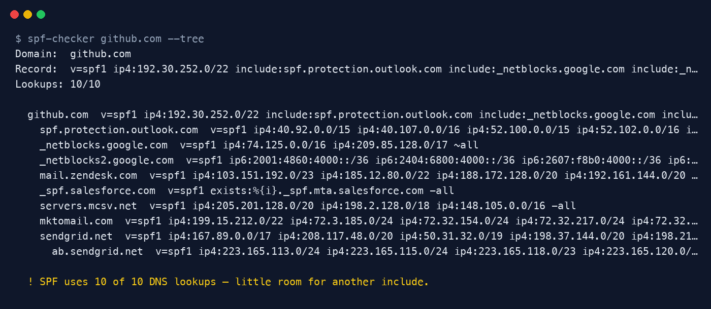
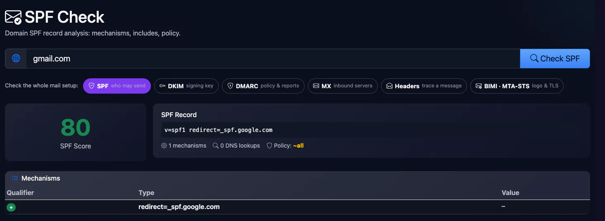
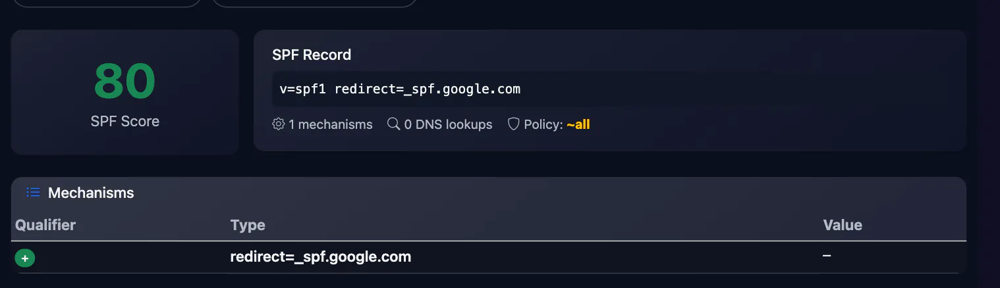

<div align="center">

# SPF Checker

**Validate your SPF record and see every include — before mail starts bouncing.**

[](https://github.com/ksanyok/spf-checker/actions/workflows/ci.yml) [](LICENSE)   [](https://promopilot.link/en/tools/spf-checker.php?utm_source=github&utm_medium=repo&utm_campaign=tools&utm_content=spf-checker)

**[▶ Use the free online version — no install, no sign-up](https://promopilot.link/en/tools/spf-checker.php?utm_source=github&utm_medium=repo&utm_campaign=tools&utm_content=spf-checker)**

</div>

`spf-checker` looks up a domain's SPF record, parses it, follows every `include:` and `redirect=` recursively and counts DNS lookups the way receiving mail servers do. It reports syntax errors, risky policies and the infamous *too many DNS lookups* `permerror` — and prints the whole include tree so you can see which vendor is eating your budget.



## What it checks

- Exactly one `v=spf1` TXT record (two records = `permerror`)
- Syntax of every mechanism and modifier, including IPv4/IPv6 ranges
- DNS lookup count across the whole include chain vs. the RFC 7208 limit of **10**
- Void lookups (includes that return nothing) vs. the limit of 2
- `+all` (anyone can send as you), `?all` (no protection), missing `all`
- Deprecated `ptr`, mechanisms after `all`, duplicate terms, ignored `redirect=`
- Includes that publish no SPF, include loops, records too long for UDP

## Why it matters

SPF tells receiving servers which hosts may send mail for your domain. A single mistake — a second SPF record added by a new email provider, an 11th DNS lookup after adding one more SaaS tool, a typo in an IP range — turns the whole policy into `permerror`, and with a DMARC policy in place your legitimate mail lands in spam or bounces. Because SPF is evaluated by the recipient, you usually find out from customers. Checking after every DNS change takes a second.

## Quick start

```bash
# run straight from GitHub, nothing to install
npx github:ksanyok/spf-checker example.com

# or install the CLI globally
npm install -g github:ksanyok/spf-checker
spf-checker example.com
```

Check a domain and show the include tree:

```bash
spf-checker example.com --tree
```

Lint a record before publishing it (no DNS needed):

```bash
spf-checker --record "v=spf1 include:_spf.google.com include:sendgrid.net ~all"
```

JSON for monitoring scripts:

```bash
spf-checker example.com --json | jq '.lookups, .issues'
```

## Example output

```text
Domain:  github.com
Record:  v=spf1 ip4:192.30.252.0/22 include:spf.protection.outlook.com include:_netblocks.google.com include:_netblocks2.google.com include:mail.zendesk.com include:_spf.salesforce.com include:servers.mcsv.net include:mktomail.com include:sendgrid.net ip4:62.253.227.114 ip4:166.78.69.169 ip4:166.78.69.170 ip4:166.78.71.131 ~all
Lookups: 10/10

  github.com  v=spf1 ip4:192.30.252.0/22 include:spf.protection.outlook.com include:_netblocks.google.com include:_netblocks2.google.com include:mail.zendesk.com include:_spf.salesforce.com include:servers.mcsv.net include:mktomail.com include:sendgrid.net ip4:62.253.227.114 ip4:166.78.69.169 ip4:166.78.69.170 ip4:166.78.71.131 ~all
    spf.protection.outlook.com  v=spf1 ip4:40.92.0.0/15 ip4:40.107.0.0/16 ip4:52.100.0.0/15 ip4:52.102.0.0/16 ip4:52.103.0.0/17 ip4:104.47.0.0/17 ip6:2a01:111:f400::/48 ip6:2a01:111:f403::/49 ip6:2a01:111:f403:8000::/51 ip6:2a01:111:f403:c000::/51 ip6:2a01:111:f403:f000::/52 -all
    _netblocks.google.com  v=spf1 ip4:74.125.0.0/16 ip4:209.85.128.0/17 ~all
    _netblocks2.google.com  v=spf1 ip6:2001:4860:4000::/36 ip6:2404:6800:4000::/36 ip6:2607:f8b0:4000::/36 ip6:2800:3f0:4000::/36 ip6:2a00:1450:4000::/36 ip6:2c0f:fb50:4000::/36 ~all
    mail.zendesk.com  v=spf1 ip4:103.151.192.0/23 ip4:185.12.80.0/22 ip4:188.172.128.0/20 ip4:192.161.144.0/20 ip4:216.198.0.0/18 ~all
    _spf.salesforce.com  v=spf1 exists:%{i}._spf.mta.salesforce.com -all
    servers.mcsv.net  v=spf1 ip4:205.201.128.0/20 ip4:198.2.128.0/18 ip4:148.105.0.0/16 -all
    mktomail.com  v=spf1 ip4:199.15.212.0/22 ip4:72.3.185.0/24 ip4:72.32.154.0/24 ip4:72.32.217.0/24 ip4:72.32.243.0/24 ip4:94.236.119.0/26 ip4:37.188.97.188/32 ip4:185.28.196.0/22 ip4:192.28.128.0/18 ip4:103.237.104.0/22 ip4:130.248.172.0/24 ip4:130.248.173.0/24 ~all
    sendgrid.net  v=spf1 ip4:167.89.0.0/17 ip4:208.117.48.0/20 ip4:50.31.32.0/19 ip4:198.37.144.0/20 ip4:198.21.0.0/21 ip4:192.254.112.0/20 ip4:168.245.0.0/17 ip4:149.72.0.0/16 ip4:159.183.0.0/16 ip4:134.128.64.0/18 ip4:159.26.176.0/20 include:ab.sendgrid.net ~all
      ab.sendgrid.net  v=spf1 ip4:223.165.113.0/24 ip4:223.165.115.0/24 ip4:223.165.118.0/23 ip4:223.165.120.0/23 ~all

  ! SPF uses 10 of 10 DNS lookups — little room for another include.
```

## CLI

```text
Usage: spf-checker <domain> [options]
       spf-checker --record "v=spf1 include:_spf.google.com ~all"

Looks up a domain's SPF record, follows every include/redirect, counts DNS
lookups against the limit of 10 and reports syntax and policy problems.

Options:
  --record <spf>    Lint a record string offline instead of querying DNS
  --json            Print the full report as JSON
  --tree            Show the include tree
  --strict          Exit with code 1 on warnings too
  -h, --help        Show this help

Online version (no install): https://promopilot.link/en/tools/spf-checker.php?utm_source=github&utm_medium=cli&utm_campaign=tools&utm_content=spf-checker
```

## Use as a library

```js
import { checkSpf, parseSpf, lintSpf } from '@promopilot/spf-checker';

const report = await checkSpf('example.com');
console.log(report.record, `${report.lookups}/10 lookups`);
for (const issue of report.issues) console.log(issue.level, issue.code, issue.message);

// Offline helpers
parseSpf('v=spf1 ip4:192.0.2.0/24 -all'); // { terms: [...], errors: [] }
lintSpf('v=spf1 +all');                   // [{ level: 'error', code: 'plus-all', ... }]

// Custom DNS (DoH, tests, a specific resolver):
await checkSpf('example.com', { resolveTxt: async (name) => myTxtLookup(name) });
```

`checkSpf(domain, { resolveTxt })` returns `{ domain, record, lookups, voidLookups, tree, issues[], ok }`. `tree` mirrors the include chain: each node has `domain`, `record`, `terms`, `lookups` and `includes[]`. Issue codes are stable (`too-many-lookups`, `multiple-spf`, `plus-all`, `loop`, …) so you can alert on specific ones.

## Use in CI (GitHub Actions)

Run it on a schedule to get an alert the day someone breaks your SPF:

```yaml
on:
  schedule: [{ cron: '0 6 * * *' }]
jobs:
  spf:
    runs-on: ubuntu-latest
    steps:
      - uses: ksanyok/spf-checker@v1
        with:
          args: example.com --strict
```

## How it works

TXT records are fetched with Node's built-in `dns/promises` resolver (multi-string records are joined as RFC 7208 §3.3 requires). The parser splits the record into mechanisms (`all`, `include`, `a`, `mx`, `ptr`, `ip4`, `ip6`, `exists`) with qualifiers and modifiers (`redirect`, `exp`). Lookup-costing terms — `include`, `a`, `mx`, `ptr`, `exists`, `redirect` — are counted, and includes/redirects are followed recursively with loop detection. Macros (`%{i}`) are counted but not expanded, since that needs a real sender IP.

## CLI vs. online version

| | This package | [Online tool](https://promopilot.link/en/tools/spf-checker.php?utm_source=github&utm_medium=repo&utm_campaign=tools&utm_content=spf-checker) |
|---|---|---|
| Runs on | Your machine, CI, cron | Any browser |
| Offline linting | Yes, `--record` | — |
| Output | Text, tree, JSON | Visual report with explanations |
| Extras | Exit codes, custom resolver | Links to DKIM, DMARC, BIMI and MX checks on one site |
| Price | Free, MIT | Free, no sign-up |





## FAQ

<details>
<summary><b>What does "too many DNS lookups" mean?</b></summary>

RFC 7208 limits SPF evaluation to 10 DNS-querying terms (`include`, `a`, `mx`, `ptr`, `exists`, `redirect`), counted across all nested includes. Above that, receivers stop and return `permerror`, which DMARC treats as a failure. Fix it by removing unused senders, replacing `a`/`mx` with `ip4`/`ip6`, or using a subdomain for bulk mail.
</details>

<details>
<summary><b>Should I use ~all or -all?</b></summary>

`~all` (softfail) is the common, safe choice while you are still discovering who sends mail for you. `-all` (fail) is stricter. With DMARC enforcement (`p=quarantine` or `p=reject`) the difference matters less, because DMARC decides the outcome. Never use `+all`.
</details>

<details>
<summary><b>I have two SPF records — is that a problem?</b></summary>

Yes. A domain must publish exactly one TXT record starting with `v=spf1`. Merge them into one: keep a single `v=spf1`, combine the mechanisms, end with one `all`.
</details>

<details>
<summary><b>Does SPF alone stop spoofing?</b></summary>

No. SPF checks the envelope sender (Return-Path), not the From address people see. You need DKIM and a DMARC policy for real protection against spoofing.
</details>

<details>
<summary><b>Why is the lookup count different from another checker?</b></summary>

Some tools count the `ip4`/`ip6` terms or skip `redirect`. This one follows RFC 7208: only the six lookup-costing terms count, `redirect` is ignored when `all` is present, and nested includes count fully.
</details>

<details>
<summary><b>Is there a version without installing anything?</b></summary>

Yes — the [online SPF Checker](https://promopilot.link/en/tools/spf-checker.php?utm_source=github&utm_medium=repo&utm_campaign=tools&utm_content=spf-checker) runs the same checks in the browser and explains each problem.
</details>

## Related free tools

- [Dmarc Checker](https://promopilot.link/en/tools/dmarc-checker.php?utm_source=github&utm_medium=repo&utm_campaign=tools&utm_content=dmarc-checker) — free online tool
- [Dkim Checker](https://promopilot.link/en/tools/dkim-checker.php?utm_source=github&utm_medium=repo&utm_campaign=tools&utm_content=dkim-checker) — free online tool
- [Bimi Checker](https://promopilot.link/en/tools/bimi-checker.php?utm_source=github&utm_medium=repo&utm_campaign=tools&utm_content=bimi-checker) — free online tool
- [Mx Lookup](https://promopilot.link/en/tools/mx-lookup.php?utm_source=github&utm_medium=repo&utm_campaign=tools&utm_content=mx-lookup) — free online tool
- [Email Header Analyzer](https://promopilot.link/en/tools/email-header-analyzer.php?utm_source=github&utm_medium=repo&utm_campaign=tools&utm_content=email-header-analyzer) — free online tool
- [All 120+ free SEO, email and web tools](https://promopilot.link/en/tools/?utm_source=github&utm_medium=repo&utm_campaign=tools&utm_content=spf-checker)

## Contributing

Bug reports and pull requests are welcome — see [CONTRIBUTING.md](CONTRIBUTING.md). Security issues: [SECURITY.md](SECURITY.md).
More docs live in the [wiki](https://github.com/ksanyok/spf-checker/wiki).

## License

[MIT](LICENSE) © 2026 Alexandr Krikun

---

<sub>Built and maintained by the team behind [PromoPilot](https://promopilot.link/?utm_source=github&utm_medium=repo&utm_campaign=tools&utm_content=spf-checker) — link building, SEO monitoring and 120+ free tools for site owners. Also on [YouTube](https://www.youtube.com/channel/UCPB8m7BgaexcZh0Vr49ViYA).</sub>
